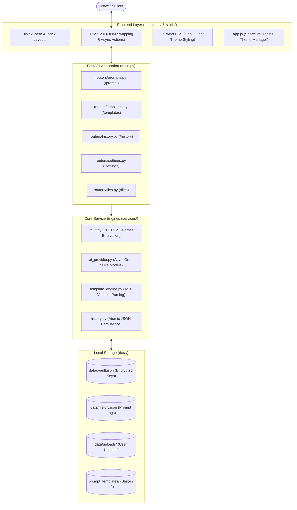

# ⚡ MAx Ops | PromptLab v1

> **Enterprise Prompt Engineering Workbench** by MAx Ops

**PromptLab v1 by MAx Ops** is an enterprise-grade developer workbench designed to make experimenting with Large Language Models (LLMs) intuitive, fast, and structured. Whether you are crafting one-off prompts, engineering complex parameterized templates with Jinja2, running side-by-side LLM Arena comparisons, or managing your personal prompt library, PromptLab v1 gives you full control right from your local machine.

---

## 💡 What is PromptLab v1? (In Simple Terms)

If you have ever used AI models for development, you know that getting production-grade results requires continuous experimentation:
- Iterating and comparing prompt variations.
- Interpolating dynamic variables (like customer data, code snippets, or parameters).
- Tuning parameters like **Temperature** (creativity vs. precision) and **Max Tokens**.
- Measuring model latency and token efficiency to control cost.

**PromptLab v1 is like an IDE for prompts:**
1. **Type & Test**: Instantly run prompts against high-speed AI models via Groq.
2. **Template Variables**: Write a prompt once with placeholders like `{{ customer_name }}` and `{{ issue }}`. PromptLab v1 automatically creates input boxes for each placeholder so you can test infinite variations without re-typing.
3. **Encrypted Vault**: Store your API keys safely on your machine using bank-grade encryption locked behind a master password.
4. **LLM Arena**: Concurrently evaluate outputs across multiple models side-by-side with latency and token-efficiency badges.
5. **Track & Rate**: Every prompt, AI response, token count, and latency (speed in milliseconds) is automatically saved so you can search, rate, and export your prompt experiments.

---

## ✨ Key Features

| Feature | Description |
| :--- | :--- |
| ⚡ **Sub-Second AI Execution** | Native integration with Groq's high-speed inference engine (`allam-2-7b`, `qwen/qwen3.8-27b`, `openai/gpt-oss-20b`, `openai/gpt-oss-120b`). |
| 🔄 **Live Model Discovery** | One-click **Sync Models** button that automatically queries the Groq API for currently active models and updates your dropdown in real time. |
| 🧩 **Dynamic Template Engine** | Full Jinja2 syntax support (`{{ variables }}`, ``, filters). Automatically extracts variables into dynamic form fields with a live **Preview** before spending tokens. |
| ⚖️ **Opt-In LLM Arena** | Concurrently run your prompt across 2 to 3 models with live latency & token metrics, performance badges (⚡ Lowest Latency, 💰 Fewest Tokens), and an interactive "🏆 Pick Winner" selector with token-burn safety guardrails. |
| 🔐 **Encrypted Vault** | Store your API keys securely on disk using **PBKDF2-HMAC-SHA256 (100,000 iterations)** key derivation and **Fernet symmetric encryption**. Zero plain-text keys on disk. |
| 📁 **Template & File Library** | Drag-and-drop or upload `.txt`, `.j2`, `.jinja2`, `.yaml`, `.json`, and `.md` files (up to 1MB). Load any file directly into the editor with one click. |
| 📜 **Prompt History & Ratings** | Persistent local JSON history tracking prompts, outputs, token metrics, latencies, timestamps, and 1-5 star ratings with live sidebar search and JSON export. |
| 🎨 **Dark & Light Mode** | Modern enterprise UI with an instant theme switcher that remembers your preference in `localStorage`. |
| 🍞 **Toast Notifications** | Non-intrusive floating toasts that provide instant visual feedback on actions, errors, and clipboard copies. |
| ⌨️ **Keyboard Shortcuts** | Control the workbench effortlessly with <kbd>Ctrl+Enter</kbd> (Send), <kbd>Ctrl+L</kbd> (Clear), <kbd>Ctrl+K</kbd> (Search), and <kbd>Esc</kbd> (Close dialogs). |

---

## 🏛️ System Architecture

**PromptLab v1 by MAx Ops** uses a modern **FastAPI + Jinja2 + HTMX** architecture. Instead of heavy frontend build steps and bloated single-page app (SPA) dependencies, the entire UI is reactive, lightweight, and server-rendered over standard HTTP.



### Architectural Decisions & Highlights
1. **Why HTMX?** 
   - Eliminates the complexity of React/Vue/Node build tooling.
   - All interactive partials (responses, model sync, dynamic variables, history searches, file cards, arena grid) are rendered as semantic HTML chunks on the server and swapped cleanly into the DOM.
2. **Why Local Encrypted JSON?**
   - No external database setup required (no PostgreSQL, MySQL, or Docker needed).
   - Your prompts, history, and files stay 100% on your machine.
   - The master password derives a unique Fernet key in memory and is never saved to disk in plain text.
3. **Atomic File Writes**:
   - History logs and vault records are written using atomic file operations (`tempfile` + atomic replace) to prevent corruption during unexpected shutdowns.

---

## 📋 Prerequisites

Before setting up PromptLab v1 by MAx Ops, ensure you have:
- **Python 3.10 or higher** installed ([Download Python](https://www.python.org/downloads/)).
- A free **Groq API Key** (Get one at [console.groq.com/keys](https://console.groq.com/keys)).

---

## 🚀 Setup & Installation (Step-by-Step)

Follow these simple steps to run PromptLab v1 by MAx Ops locally:

### 1. Open Your Terminal
Open PowerShell, Command Prompt, or your preferred terminal in the project directory:

```bash
cd promptlab
```

### 2. Create and Activate a Virtual Environment

**Windows:**
```powershell
python -m venv .venv
.\.venv\Scripts\activate
```

**macOS / Linux:**
```bash
python3 -m venv .venv
source .venv/bin/activate
```

### 3. Install Required Dependencies
```bash
pip install -r requirements.txt
```

> **Dependencies Installed:**
> - `fastapi` & `uvicorn` (high-performance web server)
> - `jinja2` (template rendering & template parsing engine)
> - `groq` (official asynchronous Groq SDK)
> - `cryptography` (PBKDF2 & Fernet encryption for API keys)
> - `python-multipart` & `aiofiles` (file uploads & async file I/O)
> - `pydantic-settings` & `python-dotenv` (configuration management)

### 4. (Optional) Configuration via `.env`
PromptLab v1 works out-of-the-box with default paths, but you can customize settings via a `.env` file if desired:

```ini
APP_NAME="PromptLab v1"
DATA_DIR=data
UPLOAD_DIR=data/uploads
HISTORY_FILE=data/history.json
VAULT_FILE=data/.vault.json
```

### 5. Launch PromptLab v1
Start the development server with live reload:

```bash
uvicorn main:app --reload --host 127.0.0.1 --port 8000
```

Alternatively, you can run:
```bash
python main.py
```

### 6. Open in Your Browser
Visit: **[http://127.0.0.1:8000](http://127.0.0.1:8000)**

---

## 🧭 First-Time Walkthrough (Your First 5 Minutes)

### Step 1: Initialize Your Encrypted Vault
1. Click **Settings** in the top-right navigation bar.
2. Enter a secure **Master Password** to initialize your local vault.
3. Select **Groq** under "Add API Key", paste your Groq API key, and click **Save Key**.
4. Your key is now encrypted on disk (`data/.vault.json`) and kept active for your current browsing session.

### Step 2: Run Your First Prompt
1. Return to the home page (`/`).
2. Notice the **Model** selector: click the **🔄 Sync Models** button to dynamically pull active models from Groq.
3. Select an active model (e.g. `allam-2-7b`).
4. Type a prompt into the editor:
   ```text
   Explain the theory of relativity in two sentences for a 10-year-old.
   ```
5. Press <kbd>Ctrl</kbd> + <kbd>Enter</kbd> (or click **Send**).
6. Observe the response card appear with:
   - Formatted Markdown output.
   - Exact latency (e.g. `310ms`).
   - Token statistics (`Prompt Tokens → Completion Tokens`).
   - One-click **📋 Copy** button with toast feedback.
   - Star rating selector (1 to 5 stars).

### Step 3: Experiment with Jinja2 Prompt Templates
1. Click the **🧩 Prompt Template** mode button at the top of the prompt form.
2. Select a built-in template from the **Load Template** dropdown (e.g., *Summarize*, *Chain of Thought*, *Few-Shot Sentiment*, or *Code Review*).
3. Notice that as the template loads, PromptLab v1 parses its Jinja2 Abstract Syntax Tree (AST) and **automatically generates individual input boxes** for each detected variable (`{{ text }}`, `{{ max_words }}`, etc.).
4. Fill in the variable fields.
5. Click **👁️ Preview Rendered Prompt** to inspect the interpolated prompt before running.
6. Click **Send** to execute!

### Step 4: Compare Models in the LLM Arena (Opt-In)
1. Click the **⚖️ LLM Arena (Optional)** tab at the top of the prompt form.
2. Read the prominent amber token warning banner:
   > ⚠️ *Token Usage Notice: The Arena executes your prompt concurrently across all chosen models. This multiplies token usage and consumes API rate limits faster.*
3. Select between 2 and 3 models (e.g., `allam-2-7b`, `qwen/qwen3.8-27b`, and `openai/gpt-oss-20b`). Notice the live counter badge (`Selected: 2/3`) and built-in guardrails (max 3 selectable, minimum 2 required to run).
4. Click **⚔️ Run Arena Comparison**.
5. Inspect the side-by-side comparison cards:
   - Compare outputs rendered side-by-side.
   - Look for the **⚡ Lowest Latency** and **💰 Fewest Tokens** performance badges.
   - Click **🏆 Pick Winner** to highlight your preferred output with an emerald glow and toast notification.

### Step 5: Use the Prompt & Template File Library
1. Click the **📁 Prompt & Template Library (Upload Files)** banner to expand the library.
2. Drag and drop any `.j2`, `.txt`, `.yaml`, `.json`, or `.md` file into the box, or click **Choose File** → **Upload File**.
3. Click any uploaded file card to load its content directly into the editor. If the file contains template tags (`{{`), PromptLab v1 automatically switches to Template mode and detects the variables instantly!

### Step 6: Explore & Search History
1. Check the left sidebar to view all past prompt runs (including Arena comparisons).
2. Use the search bar (<kbd>Ctrl</kbd> + <kbd>K</kbd>) to filter history by prompt text, AI response, or model name.
3. Click any history card to view full details in a modal or reload that exact configuration back into the editor.
4. Click **Export** to download your complete experiment history as a JSON file.

---

## ⌨️ Keyboard Shortcuts

PromptLab v1 is designed for power users who want speed without having to reach for the mouse:

| Shortcut | Action | Description |
| :--- | :--- | :--- |
| <kbd>Ctrl</kbd> + <kbd>Enter</kbd> *(or <kbd>Cmd</kbd> + <kbd>Enter</kbd>)* | **Send Prompt** | Submits the prompt form and triggers AI generation. |
| <kbd>Ctrl</kbd> + <kbd>L</kbd> *(or <kbd>Cmd</kbd> + <kbd>L</kbd>)* | **Clear Prompt** | Clears the prompt editor when focused and shows a confirmation toast. |
| <kbd>Ctrl</kbd> + <kbd>K</kbd> *(or <kbd>Cmd</kbd> + <kbd>K</kbd>)* | **Search History** | Instantly focuses and selects the sidebar history search field. |
| <kbd>Esc</kbd> | **Close Dialogs** | Closes any open modal (history detail or shortcuts cheatsheet). |

Click the **[⌨️ Shortcuts]** button in the top navbar at any time to view this cheatsheet inside the app.

---

## 📂 Project Structure

```text
promptlab/
├── config.py                 # Pydantic BaseSettings (app configuration and paths)
├── main.py                   # FastAPI application initialization & route mounting
├── requirements.txt          # Python project dependencies
├── README.md                 # Project documentation and guide
│
├── data/                     # Local data storage (created automatically)
│   ├── .vault.json           # PBKDF2-encrypted API secrets vault
│   ├── history.json          # Persistent prompt execution logs
│   └── uploads/              # Uploaded template files (.j2, .txt, .md, etc.)
│
├── prompt_templates/         # Bundled prompt templates
│   ├── chain_of_thought.j2   # Reasoning template with step-by-step breakdown
│   ├── code_review.j2        # Code review template with bug/perf criteria
│   ├── few_shot.j2           # Few-shot sentiment classification template
│   └── summarize.j2          # Multi-format document summarization template
│
├── routers/                  # FastAPI modular API routers
│   ├── __init__.py
│   ├── files.py              # File upload, validation, retrieval, and deletion (/files)
│   ├── history.py            # Prompt history search, detail, rating, export (/history)
│   ├── prompts.py            # Prompt execution, model sync & LLM Arena (/prompt)
│   ├── settings.py           # Vault initialization, unlocking, key management (/settings)
│   └── templates.py          # Dynamic variable extraction & preview (/templates)
│
├── services/                 # Backend business logic services
│   ├── __init__.py
│   ├── ai_provider.py        # Groq client integration & live model cache
│   ├── history.py            # Atomic history storage and query engine
│   ├── template_engine.py    # Jinja2 AST variable parser & safe renderer
│   └── vault.py              # PBKDF2 + Fernet encrypted credentials manager
│
├── static/                   # Static assets
│   ├── js/
│   │   └── app.js            # Toast notifications, theme manager, shortcuts, arena
│   └── style.css             # Design tokens, custom scrollbars, animations
│
└── templates/                # Jinja2 HTML templates
    ├── base.html             # Base layout, top navigation, sidebar, modals
    ├── index.html            # Main prompt playground, file library, controls, arena
    ├── settings.html         # Vault setup, unlock, and API key management
    └── partials/             # Reusable HTMX partial templates
        ├── arena_checkboxes.html   # LLM Arena dynamic model checkboxes
        ├── comparison_results.html # LLM Arena side-by-side comparison grid
        ├── error.html        # Error alert partial
        ├── file_list.html    # Interactive uploaded file cards
        ├── history_detail_modal.html # Full prompt/response inspection modal
        ├── history_list.html # Sidebar history list items
        ├── key_list.html     # Managed API key badges
        ├── provider_status.html # Live provider connection badge
        ├── response.html     # AI response card with metrics & copy action
        ├── template_preview.html # Rendered template preview card
        └── template_vars.html # Dynamic variable input fields
```

---

## 🔒 Security & Privacy Philosophy

**PromptLab v1 by MAx Ops** was designed from the ground up for developer privacy and security:

1. **Zero External Telemetry**: PromptLab v1 never sends your prompts, outputs, or statistics to any third-party server other than your chosen AI provider (e.g. Groq).
2. **Encrypted at Rest**:
   - Master passwords are never stored in plain text. A PBKDF2 hash with 100,000 iterations and a cryptographically secure random 32-byte salt verifies authentication.
   - A separate encryption salt derives a Fernet symmetric key for API keys.
3. **Session-Based Decryption**:
   - Unlocked keys exist only in server memory for the duration of your session cookie and are discarded when locked.
4. **Path Traversal Protection**:
   - File uploads and file reading endpoints strictly validate that file paths remain safely anchored inside `data/uploads/` using `pathlib.Path.is_relative_to()`.

---

## ❓ Frequently Asked Questions (FAQ)

#### Q: Do I need a paid API key to use PromptLab v1?
**A:** No. Groq provides a generous free tier with high rate limits for popular open-source models like Allam, Qwen, and GPT-OSS.

#### Q: How do I switch between Dark and Light mode?
**A:** Click the **☀️ / 🌙** icon in the top-right corner of the navigation bar. Your preference is saved automatically.

#### Q: Can I add my own prompt templates?
**A:** Yes! You can either:
1. Drop `.j2` or `.txt` files directly into the `prompt_templates/` folder.
2. Or use the **Prompt & Template Library** upload box right on the home page.

#### Q: Where are my prompt logs and API keys stored?
**A:** Everything is kept locally in the `data/` directory inside the project folder:
- `data/.vault.json`: Encrypted API keys.
- `data/history.json`: All your prompt history and ratings.
- `data/uploads/`: Your uploaded template files.

---

## 📄 License

**PromptLab v1 by MAx Ops** is open-source software licensed under the **MIT License**. Feel free to use, modify, and experiment with it for personal and commercial projects.
